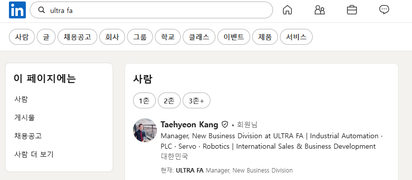
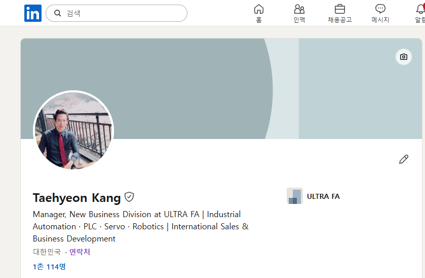
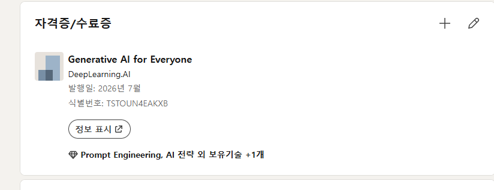

# 2년 교육계획 — 코세라 강좌별 수강계획

수정: 2026-11-16 09:52 KST

주 10시간의 개인 시간 × 연 48주 × 2년 = **960시간**. 코세라 강좌 **785시간**, 로봇 팔 실습 **143.5시간**, 보충 읽기 **31.5시간**. 아래는 실제로 들을 강좌와 수강 범위다.

수료 후 활용: [LinkedIn 검색·담당자 프로필·교육 수료 이력](#linkedin-learning).

## 피지컬 AI는 어디서 배우는가

제목의 `-` 뒤에는 이 교육이 쓰이는 분야를 적었다. **로봇 기초·공통기초는 피지컬 AI를 위한 선수학습이며, 학습 모델이 실제 팔을 움직이는 직접 실습은 6분기 ACT부터 시작한다.**

- **3–5분기 — 로봇 기초와 AI 코딩:** [Modern Robotics 1](#q3-3)·[2](#q4-3)·[3](#q5-4)에서 좌표·기구학·동역학을 배우고, [PyTorch 신경망](#q5-1)·[심층학습](#q5-2)으로 모델 학습 코드를 익힌다. [4분기 팔 설치·원격조작](#q4-4)은 실제 팔을 다루는 준비 단계다.
- **6분기 — 처음 직접 만드는 피지컬 AI:** [Computer Vision](#q6-3)으로 영상 인식을 배운 뒤 [시연 데이터 수집](#q6-6) → [ACT 모방학습·실물 실행](#q6-7)으로 연결한다. 사람이 보여 준 동작을 데이터로 모아 모델을 학습시키고, 그 모델로 작은 팔을 움직인다.
- **7분기 — 영상·언어·행동을 연결하는 피지컬 AI:** [트랜스포머](#q7-2)·[멀티모달](#q7-3)·[LLM 미세조정](#q7-4)을 배운 뒤 [SmolVLA 직접 실습](#q7-6)에서 카메라 영상과 언어 지시를 로봇 행동으로 연결하고 ACT와 비교한다.
- **8분기 — 작은 작업으로 통합:** [로봇 제어](#q8-2)·[ROS 상태 표시](#q8-4)와 앞서 학습한 동작을 [트레이 이송 실습](#q8-5)에 연결한다.

ACT·SmolVLA는 별도의 코세라 강좌명이 아니라 위 코세라 선수강좌 뒤에 공식 문서로 수행하는 실물 실습이다. 각 실습 항목에 공식 문서·키트 링크·배정 시간·교육 내용·기대효과를 적었다.

## 1분기 · 1–3개월 · 현업 필수지식에 전부 집중

**합계 120시간** — 코세라 99시간 · 로봇 팔 0시간 · 읽기 21시간.

반도체 공정·클린룸·세정·HBM·패키징을 먼저 배운다. 회사 BUSC 자료는 첫 주부터 강좌와 함께 읽는다.

### 코세라 01. Semiconductor Manufacturing Fundamentals - BUSC 기초지식·반도체 제조 개요

**한국어 주제:** 반도체 제조·클린룸 오염 관리

**수강 링크:** [코세라 강좌 페이지 — Semiconductor Manufacturing Fundamentals](https://www.coursera.org/learn/semiconductor-manufacturing-fundamentals)

**기관·수준:** Coursera · Intermediate

**학습시간:** 배정 **4.5시간**. 공식 분량 3시간 43분 2초 중 선택 범위 1시간 33분 21초.

**교육 내용:** 반도체 제조의 큰 흐름과 클린룸의 청정도·오염 관리 개념을 먼저 배운다. 제조 개요와 클린룸 환경에 해당하는 두 모듈을 선택한다.

**수강·실습 범위:** M1 반도체 제조 개요(제조 기술, 표준·규격, IDM·파운드리·팹리스), M2 클린룸 환경과 오염 관리, ISO 클린룸 등급(ISO 8~5), 산업별 등급 비교, 웨이퍼 재료, 유틸리티·기반 시설. M3(웨이퍼 제조·조립 개요와 공장 운영·확장 계획 과제)는 같은 분기의 공정 강좌와 겹쳐 제외한다.

**교육 목적:** 현재 BUSC 업무에 등장하는 제조 단계·대상물·청정 환경의 기초 용어부터 갖춘다.

**기대효과:** ISO 클린룸 등급과 오염 관리 규칙, 클린룸을 받치는 유틸리티(공기·물·가스)를 설명한다.

**회사 업무 활용·기대 효율:** 공기 청정도와 부품 표면 청정도를 같은 값으로 취급하지 않아, BUSC 적용 환경 설명이 정확해진다.

**후속 학습·기반 지식 활용:** 같은 분기 공정1·클린룸·패키징을 읽는 출발점이다. 회사의 BUSC 실무에서 제조 단계와 청정 환경 조건을 구분하는 데 바로 쓴다.

### 코세라 02. Introduction to Semiconductor Process 1 - BUSC 기초지식·반도체 전공정

**한국어 주제:** 반도체 공정 1

**수강 링크:** [코세라 강좌 페이지 — Introduction to Semiconductor Process 1](https://www.coursera.org/learn/semiconductor-process-1)

**기관·수준:** Korea Advanced Institute of Science and Technology(KAIST) · Intermediate

**학습시간:** 배정 **10.5시간**. 공식 분량 4시간 35분 24초.

**교육 내용:** CMOS 공정 흐름, 클린룸, 세정, 산화·도핑·리소그래피를 배운다. 각 공정이 재료와 표면을 어떻게 바꾸는지 구분한다.

**수강·실습 범위:** 전체 8주(MOSFET 개요, CMOS 공정 통합, 클린룸·RCA 세정·결정 성장, 확산·도핑, 산화, 이온 주입, 리소그래피, EUV).

**교육 목적:** 반도체 전공정 용어를 익히고 건식 이물 제거가 검토될 공정의 전제를 이해한다.

**기대효과:** CMOS 공정의 순서와 역할을 설명하고, RCA 세정 같은 습식 화학 세정이 무엇을 없애려는 것인지 설명한다.

**회사 업무 활용·기대 효율:** 공정명마다 뜻을 다시 찾는 빈도를 줄이고, 습식 화학 세정과 건식 이물 제거를 혼용하는 설명을 줄인다.

**후속 학습·기반 지식 활용:** 같은 분기 공정2와 내부 BUSC 자료 읽기에 사용한다. 공정 설명을 이해하고 습식 세정과 건식 이물 제거를 혼용하지 않는 데 바로 쓴다.

### 코세라 03. Cleanroom Fundamentals & Semiconductor Technologies - BUSC 실무지식·클린룸과 오염 관리

**한국어 주제:** 클린룸·반도체 기술

**수강 링크:** [코세라 강좌 페이지 — Cleanroom Fundamentals & Semiconductor Technologies](https://www.coursera.org/learn/ub-semiconductor-cleanroom-online-course)

**기관·수준:** University at Buffalo · The State University of New York · Beginner

**학습시간:** 배정 **19.5시간**. 공식 분량 9시간 24분 20초.

**교육 내용:** 클린룸의 오염 통제, 진공·증착·산화·식각·포토 공정과 가상 클린룸 활동을 배운다. 입자·공기 청정도·표면 상태를 첫 현업 학습에서 구분한다.

**수강·실습 범위:** 전체 4모듈. M2 클린룸·반도체 재료·진공·PVD, M3 CVD·도핑·산화·습식 공정·건식 식각·포토리소그래피, M4 가상 실습(포토 공정 순서, 노란 조명을 쓰는 이유, 식각 구역). 슬라이드와 추가 자료 포함.

**교육 목적:** BUSC 실무에 바로 필요한 청정 환경과 오염 관리 지식을 첫 분기에 갖춘다.

**기대효과:** 클린룸이 입자 오염을 청정 등급·공기 흐름·운영 규칙으로 관리하는 방식과 진공의 기초를 설명한다. 공정 장비가 클린룸 안에서 어떤 순서로 쓰이는지 가상 실습으로 따라간다.

**회사 업무 활용·기대 효율:** 청정 환경의 입자 관리와 제품 표면 세정을 구별해, BUSC 관련 공정 설명에서 용어와 적용 범위의 오류를 줄인다.

**후속 학습·기반 지식 활용:** 같은 분기의 BUSC·세정·기판 취급 읽기에 즉시 연결한다. 2분기 계측·수율 해석에서 공기 청정도와 표면 오염을 구분하는 바탕이다.

### 강좌 보충 읽기 · 회사 BUSC 자료 1차 읽기 - BUSC 제품 구조·세정 적용 조건

**교육 링크·자료:** 회사 내부 자료. 아래 수강·실습 범위에 적은 자료를 열람한다.

**학습시간:** 9시간.

**교육 내용:** 회사 내부 소개·설치 자료로 비접촉 건식세정의 구성과 적용 조건을 읽는다. Gap, 대상 표면, 이물과 집진·배기의 관계를 공정 기초와 연결한다.

**수강·실습 범위:** 회사 제공 BUSC 소개자료·설치 매뉴얼·브로셔·비교 자료·노즐 설명 자료(회사 내부 자료). 설치 매뉴얼의 구성·조건·높이 조절과 소개·비교자료의 대상 표면·Gap 설명을 첫 6주에 나눠 읽는다. 총 9h.

**교육 목적:** BUSC의 작동 설명과 실제 적용 조건을 회사 제공 근거의 범위에서 이해한다.

**기대효과:** 압축공기·헤드·집진 및 배기의 구성과 Gap·표면·이물 조건을 구분한다. 건식세정이 가능하고, 이물이 불량으로 이어지며, 그 이물 제거로 개선을 기대할 수 있는 공정이라는 대상 조건을 설명한다.

**회사 업무 활용·기대 효율:** 제품 기능 설명과 적용 가능 조건을 분리해 말할 수 있어, 세정 방식이나 적용 대상의 혼선을 줄인다.

**후속 학습·기반 지식 활용:** 메모리·트레이·기판·이송·필름에서 BUSC의 건식세정 대상 조건을 이해하는 데 바로 사용한다. 2분기 계측·DoE 후 재독하여 적용 조건의 의미를 더 깊게 읽는다.

### 강좌 보충 읽기 · HBM 구조 첫 읽기 - HBM 기초지식·적층 메모리 구조

**교육 링크·자료:** [삼성전자 HBM](https://semiconductor.samsung.com/kr/dram/hbm/) · [SK하이닉스 HBM3E 적층](https://news.skhynix.com/en/sk-hynix-begins-volume-production-of-the-world-first-12-layer-hbm3e/)

**학습시간:** 3시간.

**교육 내용:** 제조사 공개 자료에서 DRAM 다이 적층과 TSV의 역할을 읽는다. 세대·적층 구조와 공정의 큰 흐름을 먼저 잡는다.

**수강·실습 범위:** 삼성전자 HBM 소개 페이지와 [SK하이닉스 12단 HBM3E 양산 발표](https://news.skhynix.com/en/sk-hynix-begins-volume-production-of-the-world-first-12-layer-hbm3e/)를 읽는다.

**교육 목적:** HBM이 단일 칩 이름만이 아니라 적층·접속·시험이 연결된 제품임을 이해한다.

**기대효과:** HBM이 DRAM 다이를 쌓고 TSV로 잇는 구조라는 점과 세대·적층 수 표기를 읽습니다.

**회사 업무 활용·기대 효율:** HBM 관련 기사·기술 설명에서 제품 세대와 공정 구조를 구별해, 장비·소재 업체의 역할을 더 빠르게 이해한다.

**후속 학습·기반 지식 활용:** 같은 분기 패키징·적층 읽기와 3분기 기판·시험 장비 읽기의 바탕이다. HBM 관련 소재·장비 업체의 역할을 이해하는 데 즉시 사용한다.

### 코세라 04. Introduction to Semiconductor Process 2 - HBM 제조공정·식각·증착·CMP

**한국어 주제:** 반도체 공정 2

**수강 링크:** [코세라 강좌 페이지 — Introduction to Semiconductor Process 2](https://www.coursera.org/learn/semiconductor-process-2)

**기관·수준:** Korea Advanced Institute of Science and Technology(KAIST) · Intermediate

**학습시간:** 배정 **12시간**. 공식 분량 5시간 34분 5초.

**교육 내용:** 식각·증착·배선·CMP와 DRAM·첨단 패키징 공정을 다룬다. 전공 공정 지식을 HBM 구조와 연결한다.

**수강·실습 범위:** 전체 9주(습식 식각, 플라즈마·건식 식각, 박막 증착 1·2, 금속 배선·CMP, 전자 패키징, 2.5D/3D 첨단 패키징, DRAM 공정, 3D 트랜지스터).

**교육 목적:** 공정 전후의 재료·표면 상태가 달라지는 이유를 설명한다.

**기대효과:** 식각·증착·CMP·배선 공정과 DRAM 공정, 2.5D/3D 패키징의 순서를 설명한다.

**회사 업무 활용·기대 효율:** 세정으로 다룰 표면 이물과 식각·배선 등 다른 원인의 결함을 구별해, BUSC 적용 설명의 정확도를 높인다.

**후속 학습·기반 지식 활용:** 같은 분기 패키징 제조와 세정·CMP 읽기에 이어진다. BUSC가 다룰 표면 이물과 식각·배선 등 다른 공정 원인을 구분하는 현재 업무의 기반이다.

### 코세라 05. Introduction to Semiconductor Packaging - HBM·BUSC 관련 지식·패키지와 기판 구조

**한국어 주제:** 반도체 패키징 구조

**수강 링크:** [코세라 강좌 페이지 — Introduction to Semiconductor Packaging](https://www.coursera.org/learn/introduction-to-semiconductor-packaging)

**기관·수준:** Arizona State University · Mixed

**학습시간:** 배정 **21시간**. 공식 분량 10시간 14분 58초.

**교육 내용:** 패키징의 기능과 패키지·기판·접속 구조를 학습한다. 칩 내부 공정과 패키지 조립 영역을 구분한다.

**수강·실습 범위:** 전체 9모듈(나노전자, 패키징이란 1·2, 패키지 구조 1~4, 요약).

**교육 목적:** HBM·기판·트레이·시험 단계의 물리적 연결을 설명한다.

**기대효과:** 패키지가 칩을 보호하고 전기·열을 연결하는 역할과, 다이·접합부·봉지재·기판의 구조를 구분합니다.

**회사 업무 활용·기대 효율:** 기판, 다이, 패키지, 인터포저를 혼용하는 빈도를 줄여 소재·장비 업체의 기술 설명을 더 빠르게 이해한다.

**후속 학습·기반 지식 활용:** 같은 분기 패키징 제조·첨단 패키징, 3분기 FC-BGA·핸들러 읽기에 사용한다. 회사의 기판·트레이·이송 분야 기술영업에서 대상물의 구조를 구분한다.

### 코세라 06. Semiconductor Packaging Manufacturing - BUSC 관련 공정지식·패키지 조립·시험·취급

**한국어 주제:** 반도체 패키징 제조

**수강 링크:** [코세라 강좌 페이지 — Semiconductor Packaging Manufacturing](https://www.coursera.org/learn/manufacturing)

**기관·수준:** Arizona State University · Beginner

**학습시간:** 배정 **18시간**. 공식 분량 8시간 53분 13초.

**교육 내용:** 패키지 조립, 시험·마무리와 공정 관리의 기본을 배운다. 구조가 실제 제조 순서로 구현되는 과정을 연결한다.

**수강·실습 범위:** 전체 8모듈(제조 개요 1·2, 조립 1·2, 시험·마무리, 공정 관리 시스템(PCS), 요약).

**교육 목적:** 조립·취급·시험의 순서와 단계별 결함 발생 가능성을 이해한다.

**기대효과:** 패키징 제조의 조립·시험·마무리 단계와 공정 관리(관리도 등)가 어떻게 이어지는지 설명한다.

**회사 업무 활용·기대 효율:** 세정 대상의 앞뒤 공정을 구별해, 이물이 유입될 수 있는 단계와 이미 발생한 결함을 혼동하는 설명을 줄인다.

**후속 학습·기반 지식 활용:** 같은 분기 세정·기판 취급과 2분기 계측에서 조립·취급·시험 순서를 해석하는 기반이다. BUSC 적용 공정의 앞뒤 단계를 이해하는 데 바로 쓴다.

### 코세라 07. Advanced Semiconductor Packaging - HBM 관련 지식·2.5D·3D 패키징

**한국어 주제:** 첨단 반도체 패키징

**수강 링크:** [코세라 강좌 페이지 — Advanced Semiconductor Packaging](https://www.coursera.org/learn/advanced-packaging)

**기관·수준:** Arizona State University · Beginner

**학습시간:** 배정 **13.5시간**. 공식 분량 6시간 12분 36초.

**교육 내용:** 패키징 추세와 이종 집적, 여러 다이·기판의 연결을 학습한다. 전통 패키징에서 HBM 주변 집적 구조로 범위를 넓힌다.

**수강·실습 범위:** 전체 6모듈(패키징 추세 1·2, 이종 집적 1·2, 요약).

**교육 목적:** HBM·인터포저·기판의 관계와 집적 단계별 제조 요구를 설명한다.

**기대효과:** 이종 집적과 첨단 패키징(2.5D·3D)의 연결 구조와 제약을 설명한다.

**회사 업무 활용·기대 효율:** 소재·기판·시험 장비의 역할을 구조에 맞춰 이해해, 반도체 기술영업의 공정 구분이 더 정확해진다.

**후속 학습·기반 지식 활용:** 같은 분기 HBM 적층·이종 집적 읽기를 구체화한다. 메모리 주변 기판·접속·취급 장비가 담당하는 공정 위치를 이해하는 데 쓴다.

### 강좌 보충 읽기 · HBM 적층·이종 집적 읽기 - HBM 제조지식·적층과 이종 집적

**교육 링크·자료:** [SK하이닉스 HBM3E 적층](https://news.skhynix.com/en/sk-hynix-begins-volume-production-of-the-world-first-12-layer-hbm3e/) · [삼성전자 이종 집적](https://semiconductor.samsung.com/foundry/advanced-package/advanced-heterogeneous-integration/)

**학습시간:** 4.5시간.

**교육 내용:** HBM 적층 관련 발표와 이종 집적 구조를 다시 읽는다. TSV, 얇은 다이의 적층, 접합·보호 재료, 패키지 접속의 역할을 구분한다.

**수강·실습 범위:** SK하이닉스 12단 HBM3E 발표를 TSV·박막화·적층·몰딩 관점으로 다시 읽고, 삼성전자 이종 집적 페이지를 읽습니다.

**교육 목적:** 제품 구조와 제조·패키징 단계를 연결한다.

**기대효과:** TSV·박막화·적층·봉지(몰딩)와 열·휨 문제가 어떻게 이어지는지 읽습니다.

**회사 업무 활용·기대 효율:** HBM 소재·기판·시험 장비 설명을 읽을 때 서로 다른 공정 단계를 섞는 오류를 줄인다.

**후속 학습·기반 지식 활용:** HBM의 구조와 적층·접합·보호 재료를 연결해 현재 소재·장비 설명을 읽는다. 3분기 기판·핸들러 자료를 공정 관점으로 읽는 바탕이다.

### 강좌 보충 읽기 · 세정·기판 취급 읽기 - BUSC 관련 지식·세정과 재오염

**교육 링크·자료:** [SK하이닉스 CLEAN·CMP](https://news.skhynix.com/en/creating-defectless-wafers-a-look-at-clean-cmp-technology/) · [삼성전자 세정공정](https://semiconductor.samsung.com/kr/support/tools-resources/dictionary/zero-residue-zero-contaminants-semiconductor-cleaning/) · [Entegris 기판 취급](https://www.entegris.com/en/home/our-science/by-solution-area/substrate-handling.html)

**학습시간:** 4.5시간.

**교육 내용:** 제조사 CLEAN·CMP·세정 설명과 기판 취급 자료를 읽는다. 오염 제거와 이송 중 재오염을 구별한다.

**수강·실습 범위:** SK하이닉스 CLEAN·CMP, 삼성전자 세정공정, Entegris 기판 취급 자료를 첫 분기 강좌와 함께 읽는다. 습식/건식의 목적, 입자·잔류물, 이송·접촉의 재오염을 구분한다. 총4.5h.

**교육 목적:** 세정 전후 취급 조건까지 포함해 공정의 청정 상태를 이해한다.

**기대효과:** 제조사가 습식·건식 세정을 나누는 기준, CMP 뒤 세정, 기판을 옮기고 보관할 때의 오염 관리 방식을 설명한다.

**회사 업무 활용·기대 효율:** 세정 기능만 보고 이송·접촉에서 다시 생기는 오염을 놓치는 설명을 줄인다.

**후속 학습·기반 지식 활용:** 세정 후 이송·접촉에서 재오염될 수 있는 조건을 BUSC 자료와 연결해 현재 업무에 사용한다. 2분기 계측·실험 설계의 비교 조건을 이해하는 기반이다.

**이 순서로 듣는 이유:** 반도체 제조·공정1/2 → 클린룸·오염 → HBM·패키징·취급을 배우며 회사 BUSC 자료를 병행한다. 수학·프로그래밍·일반 AI·로봇 학습은 편성하지 않는다.

**3개월 후 도달 목표:** 공정의 큰 순서와 청정 환경·제품 표면 오염의 차이를 설명한다. BUSC의 건식세정 대상 조건, Gap·표면·이물·집진 조건을 구분하고 HBM 주변 기판·이송·시험의 위치를 이해한다.

## 2분기 · 4–6개월 · 계측·수율 이해를 앞당기고 정량 기반 보강

**합계 120시간** — 코세라 112.5시간 · 로봇 팔 0시간 · 읽기 7.5시간.

### 강좌 보충 읽기 · 반도체 계측 선수 읽기: PN·MOSFET·I–V - 반도체 계측 기초·소자 전기특성

**교육 링크·자료:** [MIT PN 접합 I–V: Lecture 14, 인쇄 p2–3](https://ocw.mit.edu/courses/6-012-microelectronic-devices-and-circuits-spring-2009/a3aa1722b1c2e732dfe4c4be0c7b0631_MIT6_012S09_lec14.pdf) · [MIT MOSFET I–V: Lecture 8, 인쇄 p2–7·15–17](https://ocw.mit.edu/courses/6-012-microelectronic-devices-and-circuits-spring-2009/1aadf127cb5e71ec1577aa244e2b3773_MIT6_012S09_lec08.pdf)

**학습시간:** 1.5시간.

**교육 내용:** 대학 공개 자료에서 PN 접합과 MOSFET의 기본 전류–전압 곡선을 읽는다. 소자 설계 대신 측정 곡선의 축·바이어스·동작 상태에 집중한다.

**수강·실습 범위:** MIT Lecture14 인쇄 p2–3 PN 접합·I–V 20분, Lecture8 인쇄 p2–7·15–17 MOSFET 구조·동작 영역·I–V 50분, 곡선의 축·바이어스·동작 상태를 스스로 설명하는 복습20분. 총1.5h. 상세 유도와 회로 설계는 제외한다.

**교육 목적:** 계측 강좌가 요구하는 소자·I–V 선수 개념을 짧게 보충한다.

**기대효과:** PN 접합·MOSFET의 기본 I–V 곡선에서 축·단자·바이어스·동작 영역을 구분한다. 실제 누설·불량 원인 확정을 할 수 있다고 해석하지 않는다.

**회사 업무 활용·기대 효율:** 전기 측정의 대상과 조건을 구분해, 결함 원인을 표면 이물에 잘못 연결하는 해석을 줄인다.

**후속 학습·기반 지식 활용:** 곧바로 뒤의 계측 기초에서 I–V 곡선의 축·단자·바이어스를 구분하는 데 쓴다. 전기적 결함과 BUSC의 표면 이물 제거 영역을 혼동하지 않는 기반이다.

### 코세라 08. Diagnose Yield with Metrology Basics - BUSC 관련 지식·반도체 계측과 수율

**한국어 주제:** 계측으로 수율 문제 읽기

**수강 링크:** [코세라 강좌 페이지 — Diagnose Yield with Metrology Basics](https://www.coursera.org/learn/diagnose-yield-with-metrology-basics)

**기관·수준:** Coursera · Intermediate

**학습시간:** 배정 **6시간**. 공식 분량 3시간 27분 7초.

**교육 내용:** 전기 측정법과 인라인 검사 차트의 용도, 결함 분류를 예제로 익힌다. 공정·클린룸 기초와 소자 곡선 읽기 바로 다음에 시작한다.

**수강·실습 범위:** 전체3모듈. 측정법 선택, 인라인 차트와 결함 분류, 수율 이탈 원인 가설을 읽는다. 배정 여유에서 예제의 평균·산포·추세 의미를 복습한다. 기초 계측 교육을 Python·전체 통계 강좌 수료 뒤로 미루지 않으며, 통계적 인과 추론은 뒤 과정에서 보강한다.

**교육 목적:** 현재 공정 설명에서 어떤 현상을 어떤 측정으로 보는지 먼저 구분한다.

**기대효과:** 예제의 I–V·C–V·연속성 측정 목적과 기본 추세·이상 패턴을 구분하고, 이물성 결함으로 단정할 수 없는 경우를 설명한다.

**회사 업무 활용·기대 효율:** 결함이 있다는 사실만으로 원인을 이물로 단정하지 않고, 어떤 측정이 필요한지 구별해 기술 대화의 정확도를 높인다.

**후속 학습·기반 지식 활용:** 현재 업무에서 측정법·결함 종류·공정 조건을 구분하는 데 먼저 쓴다. 뒤의 통계·DoE는 이 경험의 불확실성과 조건 비교를 정량적으로 보강한다.

### 코세라 09. Programming for Everybody (Getting Started with Python) - 일반 AI·피지컬 AI 공통기초·Python 코딩

**한국어 주제:** 파이썬 프로그래밍 기초

**수강 링크:** [코세라 강좌 페이지 — Programming for Everybody (Getting Started with Python)](https://www.coursera.org/learn/python)

**기관·수준:** University of Michigan · Beginner

**학습시간:** 배정 **27시간**. 공식 분량 17시간 1분 33초.

**교육 내용:** 변수·조건문·함수·반복문을 배우며 짧은 프로그램을 직접 작성한다. 영어 설명을 듣고 강좌의 코딩 과제를 실행한다.

**수강·실습 범위:** 전체 7모듈(설치, 변수·식, 조건문, 함수, 반복문)과 강좌 안 코딩 과제.

**교육 목적:** 현업 기초 학습 뒤, 확률통계 코딩 과제와 향후 AI 학습을 수행할 최소 프로그래밍 기반을 갖춘다.

**기대효과:** 변수·조건문·함수·반복문으로 작은 파이썬 프로그램을 짜고, 오류 메시지를 읽어 스스로 고칩니다.

**회사 업무 활용·기대 효율:** 같은 분기 통계 예제의 입력·반복 계산 코드를 읽고 간단한 오류를 고칠 수 있어, 표본·측정 데이터 해석을 연습하는 속도가 높아진다.

**후속 학습·기반 지식 활용:** 같은 분기 데이터 구조·확률통계의 Python 과제를 수행하는 데 사용한다. 이후 4분기 머신러닝과 로봇 설정 코드를 읽는 공통 기반이 된다.

### 코세라 10. Python Data Structures - 일반 AI·피지컬 AI 공통기초·데이터 처리

**한국어 주제:** 파이썬 데이터 구조

**수강 링크:** [코세라 강좌 페이지 — Python Data Structures](https://www.coursera.org/learn/python-data)

**기관·수준:** University of Michigan · Beginner

**학습시간:** 배정 **24시간**. 공식 분량 19시간 50분 42초 중 선택 범위 15시간 28분 19초.

**교육 내용:** 문자열·파일·리스트·딕셔너리·튜플을 다룬다. 설치 반복을 제외하고 실제 데이터 처리 구간을 학습한다.

**수강·실습 범위:** M1 문자열, M3 파일, M4 리스트, M5 딕셔너리, M6 튜플. M2(설치, 앞 강좌와 겹침)와 M7(수료 안내)은 제외한다.

**교육 목적:** 측정·표본 데이터를 Python 자료구조로 다룰 기반을 갖춘다.

**기대효과:** 문자열·파일·리스트·딕셔너리로 데이터를 읽고, 묶고, 세는 코드를 씁니다.

**회사 업무 활용·기대 효율:** 표본값을 파일에서 읽고 조건별로 묶어 볼 수 있어, 통계 과제와 공정 자료의 구조를 파악하는 반복 작업이 줄어든다.

**후속 학습·기반 지식 활용:** 같은 분기 확률통계의 표본 데이터를 읽고 묶는 데 사용한다. 6분기 로봇 시연의 영상·관절값·에피소드 구조를 다루는 바탕이다.

### 코세라 11. Probability & Statistics for Machine Learning & Data Science - 반도체 수율 해석·AI 공통기초·확률통계

**한국어 주제:** 머신러닝 확률·통계

**수강 링크:** [코세라 강좌 페이지 — Probability & Statistics for Machine Learning & Data Science](https://www.coursera.org/learn/machine-learning-probability-and-statistics)

**기관·수준:** DeepLearning.AI · Intermediate

**학습시간:** 배정 **51시간**. 공식 분량 33시간 28분 6초.

**교육 내용:** 확률분포·표본·추정·신뢰구간·가설검정을 Python 과제로 학습한다. 앞에서 본 공정·계측 사례의 변동과 불확실성을 정량적으로 해석한다.

**수강·실습 범위:** 전체 4주(확률·분포, 분포 기술·다변량, 표본·점추정, 신뢰구간·가설검정)와 파이썬 과제.

**교육 목적:** 공정·시험 결과의 차이를 표본·변동·조건 차이와 함께 해석한다.

**기대효과:** 확률분포·기댓값·분산을 계산하고, 표본으로 모수를 추정하며, 신뢰구간과 가설검정으로 차이가 우연인지 판단합니다.

**회사 업무 활용·기대 효율:** 작은 표본이나 조건이 다른 결과를 직접 비교하는 오류를 줄여, 로봇 시연과 공정 시험 결과의 해석을 정확하게 한다.

**후속 학습·기반 지식 활용:** 같은 분기 DoE와 BUSC 자료 재독에서 표본·변동·조건 차이를 해석하는 데 쓴다. 4·5분기 머신러닝과 7분기 정책 비교에도 사용한다.

### 코세라 12. Optimize Yield with DoE and 8D - BUSC 관련 지식·공정 실험과 수율 원인 해석

**한국어 주제:** 실험 설계로 수율 원인 구분하기

**수강 링크:** [코세라 강좌 페이지 — Optimize Yield with DoE and 8D](https://www.coursera.org/learn/optimize-yield-with-doe-and-8d)

**기관·수준:** Coursera · Intermediate

**학습시간:** 배정 **4.5시간**. 공식 분량 2시간 12분 22초.

**교육 내용:** 부분요인 실험, 주효과·교호작용·분산분석을 배운다. 관찰된 상관관계와 조건을 통제한 비교를 구분한다.

**수강·실습 범위:** 전체3모듈의 부분요인 실험·주효과·교호작용·ANOVA·원인 가설 비교. 공개 강의 목록에서 8D 전체 단계 교육은 확인되지 않아 이를 교육 효과로 약속하지 않는다. 강좌 자체 활동만 수행하며 별도 회사 양식을 만들지 않는다.

**교육 목적:** 여러 공정 조건이 섞인 자료에서 원인 가설을 구분한다.

**기대효과:** 선별 실험을 설계하고(인자·무작위 순서·반응), 주효과·교호작용과 분산분석으로 영향이 큰 인자를 고릅니다.

**회사 업무 활용·기대 효율:** 세정 조건·대상 상태·측정 조건이 다른 결과를 같은 기준으로 비교하는 오류를 줄인다.

**후속 학습·기반 지식 활용:** BUSC 자료의 시험 조건과 비교 가능 범위를 읽는 데 쓴다. 이후 로봇 실습에서 장면·데이터 조건을 통제해 비교하는 기반이 된다.

### 강좌 보충 읽기 · 회사 BUSC 자료 2차 읽기 - BUSC 적용 조건·시험 조건 이해

**교육 링크·자료:** 회사 내부 자료. 아래 수강·실습 범위에 적은 자료를 열람한다.

**학습시간:** 6시간.

**교육 내용:** 처음 읽은 회사 자료를 공정·클린룸·통계·계측·실험 설계 지식으로 다시 읽는다. 조건별 설명과 자료에 없는 정보를 구분한다.

**수강·실습 범위:** 회사 제공 BUSC 설치 매뉴얼과 소개자료·브로셔·비교 자료 재독(회사 내부 자료). 구성·표면·거리·집진·측정 조건을 공정·계측·통계·DoE와 연결한다. 총6h.

**교육 목적:** BUSC의 설명을 제조 공정과 측정 조건의 언어로 이해한다.

**기대효과:** BUSC 설명의 시험 전제·대상 표면·이물·거리·집진 조건을 분리해 읽고, 자료만으로 단정할 수 없는 공정 적용 여부를 구분한다.

**회사 업무 활용·기대 효율:** 제품 설명, 적용 조건, 추가 확인이 필요한 사항을 구별해 기술영업에서 부정확한 적용 설명을 줄인다.

**후속 학습·기반 지식 활용:** 현재 BUSC 실무에서 제품 설명·시험 조건·아직 확인되지 않은 적용 범위를 분리한다. 이후에도 메모리·기판·이송·필름 관련 자료를 읽는 기준으로 쓴다.

**이 순서로 듣는 이유:** 소자 곡선 읽기·계측 기초부터 시작한다. 이어 Python과 통계 코딩을 익혀 DoE·BUSC 재독에서 조건·표본·변동의 차이를 더 깊게 해석한다.

**6개월 후 도달 목표:** 측정 목적과 결함 종류를 예제 수준에서 구별한다. Python으로 표본 자료를 다루고 통계·실험 설계의 기본 개념으로 BUSC 자료의 시험 조건을 읽는다.

## 3분기 · 7–9개월 · 업무 기반 위에 로봇·AI 공통수학 시작

**합계 120시간** — 코세라 117시간 · 로봇 팔 0시간 · 읽기 3시간.

### 코세라 13. Linear Algebra for Machine Learning and Data Science - 일반 AI·피지컬 AI 공통수학·벡터와 행렬

**한국어 주제:** 머신러닝·데이터 과학 선형대수

**수강 링크:** [코세라 강좌 페이지 — Linear Algebra for Machine Learning and Data Science](https://www.coursera.org/learn/machine-learning-linear-algebra)

**기관·수준:** DeepLearning.AI · Intermediate

**학습시간:** 배정 **52.5시간**. 공식 분량 34시간 8분 56초.

**교육 내용:** 연립방정식, 벡터, 행렬, 선형변환, 행렬식과 고유벡터를 NumPy 과제로 학습한다. 선형대수는 처음부터 시작한다.

**수강·실습 범위:** 전체 4주(연립방정식, 소거법·계수, 벡터·선형변환, 행렬식·고유벡터)와 NumPy 과제.

**교육 목적:** 로봇 좌표와 AI 텐서 연산을 공통된 수학으로 이해한다.

**기대효과:** 연립방정식을 행렬로 풀고, 행렬 곱이 좌표 변환이라는 점과 고윳값·고유벡터의 뜻을 NumPy로 계산하며 익힙니다.

**회사 업무 활용·기대 효율:** 좌표계·행렬 크기·변환 방향을 읽을 수 있어, 로봇 위치 오류나 데이터 형상 오류를 설명할 때 혼동을 줄인다.

**후속 학습·기반 지식 활용:** 같은 분기 로봇 좌표 표현과 6분기 최소제곱·SVD에 사용한다. 향후 로봇 SI에서 카메라·작업물·팔 좌표를 연결하는 기반이다.

### 코세라 14. Mathematics for Machine Learning: Multivariate Calculus - 일반 AI·피지컬 AI 공통수학·미분과 최적화

**한국어 주제:** 머신러닝 다변수 미적분

**수강 링크:** [코세라 강좌 페이지 — Mathematics for Machine Learning: Multivariate Calculus](https://www.coursera.org/learn/multivariate-calculus-machine-learning)

**기관·수준:** Imperial College London · Beginner

**학습시간:** 배정 **27시간**. 공식 분량 17시간 45분 11초.

**교육 내용:** 미분, 편미분, 연쇄법칙, 선형화와 최적화를 Python 예제로 배운다. 도함수가 모델의 갱신과 민감도를 나타내는 방식에 집중한다.

**수강·실습 범위:** 전체 6모듈(미분 개념, 다변수 미분, 연쇄법칙, 테일러 급수·선형화, 최적화 입문, 회귀)과 파이썬 실습.

**교육 목적:** AI 학습의 경사하강과 로봇 속도 기구학을 수식으로 이해한다.

**기대효과:** 편미분·연쇄법칙·테일러 근사로 여러 변수 함수의 변화를 계산하고, 기울기를 따라 최솟값을 찾는 원리를 익힙니다.

**회사 업무 활용·기대 효율:** 학습률·기울기·변화율을 구분해, 모델 설정의 의미를 설명하거나 위치·속도 문제를 읽을 때 재해석을 줄인다.

**후속 학습·기반 지식 활용:** 4분기 회귀·분류·Jacobian·미분방정식, 5분기 신경망 최적화의 선수다. 로봇+AI 시스템의 오차 변화와 학습 갱신을 이해하는 데 사용한다.

### 코세라 15. Modern Robotics, Course 1:  Foundations of Robot Motion - 피지컬 AI 로봇 기초·위치·자세·좌표

**한국어 주제:** 로봇 운동의 수학적 기초

**수강 링크:** [코세라 강좌 페이지 — Modern Robotics, Course 1:  Foundations of Robot Motion](https://www.coursera.org/learn/modernrobotics-course1)

**기관·수준:** Northwestern University · Intermediate

**학습시간:** 배정 **37.5시간**. 공식 분량 24시간 5분 6초.

**교육 내용:** 구성 공간, 자유도, 회전행렬·동차변환, 강체 운동과 twist를 학습한다. 강좌 라이브러리와 시뮬레이션으로 수식의 의미를 확인한다.

**수강·실습 범위:** 전체 5모듈(개요, 2장 구성 공간, 3장 강체 운동)과 강좌 파이썬 라이브러리·시뮬레이션.

**교육 목적:** 로봇의 위치·자세와 관절 상태를 서로 다른 표현으로 다룬다.

**기대효과:** 자유도와 구성 공간을 세고, 회전 행렬·동차 변환·트위스트로 물체의 위치와 자세를 계산합니다.

**회사 업무 활용·기대 효율:** 공정 배치 논의에서 작업 공간·자유도·좌표계 용어를 정확하게 사용해, 로봇이 도달 가능한 동작에 관한 오해를 줄인다.

**후속 학습·기반 지식 활용:** 4분기 기구학과 팔 보정으로 이어진다. 회사의 신규 로봇 SI 영역에서 작업 공간·자유도·좌표 표현을 이해하는 기반이다.

### 강좌 보충 읽기 · HBM·FC-BGA·테스트 핸들러 읽기 - HBM·BUSC 관련 지식·기판과 테스트 핸들러

**교육 링크·자료:** [삼성전자 HBM](https://semiconductor.samsung.com/kr/dram/hbm/) · [SK하이닉스 HBM3E 적층](https://news.skhynix.com/en/sk-hynix-begins-volume-production-of-the-world-first-12-layer-hbm3e/) · [삼성전기 FC-BGA](https://www.samsungsem.com/global/product/substrate/package-substrate/fcbga.do) · [Advantest 테스트 핸들러](https://www.advantest.com/en/products/component-test-system/test-handler/m5241/)

**학습시간:** 3시간.

**교육 내용:** 제조사의 HBM·FC-BGA·테스트 핸들러 공개 자료를 읽는다. 제품 구조와 시험 중 취급·이송의 역할을 연결한다.

**수강·실습 범위:** 이미 읽은 HBM 자료를 짧게 재확인하고 삼성전기 FC-BGA와 Advantest M5241 테스트 핸들러 원문에서 기판·시험·취급의 역할에 집중한다. 총3h. 특정 업체의 BUSC 사용 근거로 해석하지 않는다.

**교육 목적:** HBM을 지원하는 기판과 시험 장비가 담당하는 기능을 구분한다.

**기대효과:** 메모리 적층, 패키지 기판(FC-BGA), 시험 핸들러가 HBM 생태계에서 각각 맡는 자리를 설명한다.

**회사 업무 활용·기대 효율:** 반도체 소재·장비 업체의 설명을 패키징·시험 단계에 맞춰 읽어, BUSC 적용 가능 공정에 대한 질문의 정확도를 높인다.

**후속 학습·기반 지식 활용:** 앞서 배운 현업 공정 지식을 제품 자료에 다시 연결한다. 메모리 주변 기판·시험 장비의 역할을 구분해 BUSC 관련 기술 설명을 더 정확히 읽는다.

**이 순서로 듣는 이유:** 선형대수·미적분을 배운 뒤 로봇 위치·자세를 수학적으로 표현한다. HBM·FC-BGA·시험 장비 읽기로 현재 업무 지식도 연결한다.

**9개월 후 도달 목표:** 벡터·행렬·미분으로 좌표와 변화율을 계산하고, 로봇의 구성 공간·위치·자세를 표현한다. 기판·시험 장비의 역할을 앞서 배운 패키징과 연결한다.

## 4분기 · 10–12개월 · 일반 머신러닝과 로봇 기구학 병행

**합계 120시간** — 코세라 100.5시간 · 로봇 팔 19.5시간 · 읽기 0시간.

### 코세라 16. Supervised Machine Learning: Regression and Classification - 일반 AI 개발·회귀와 분류

**한국어 주제:** 지도학습: 회귀와 분류

**수강 링크:** [코세라 강좌 페이지 — Supervised Machine Learning: Regression and Classification](https://www.coursera.org/learn/machine-learning)

**기관·수준:** DeepLearning.AI · Beginner

**학습시간:** 배정 **51시간**. 공식 분량 33시간 19분 51초.

**교육 내용:** NumPy·scikit-learn으로 선형 회귀와 로지스틱 분류를 구현한다. 비용함수·경사하강·정규화를 코딩 랩에서 익힌다.

**수강·실습 범위:** 전체 3주(머신러닝 개요, 다변수 회귀, 분류)와 코딩 랩.

**교육 목적:** 입력 데이터에서 예측을 만드는 일반 AI 모델을 직접 학습한다.

**기대효과:** 선형 회귀·로지스틱 회귀·정규화·경사하강을 직접 구현하고, 과적합과 데이터 양의 관계를 봅니다.

**회사 업무 활용·기대 효율:** 입력 특성·정답 레이블·손실과 정규화의 역할을 이해해, AI 기능 논의에서 어떤 데이터가 필요한지 더 정확히 짚는다.

**후속 학습·기반 지식 활용:** 5분기 신경망·모델 진단과 6분기 영상·ACT의 선수다. 회사의 후속 AI 기능 논의에서 필요한 입력과 정답 데이터의 조건을 이해한다.

### 코세라 17. Differential Equations for Engineers - 피지컬 AI 로봇 수학·동작의 시간 변화

**한국어 주제:** 공학 미분방정식 1부

**수강 링크:** [코세라 강좌 페이지 — Differential Equations for Engineers](https://www.coursera.org/learn/differential-equations-engineers)

**기관·수준:** The Hong Kong University of Science and Technology · Beginner

**학습시간:** 배정 **21시간**. 공식 분량 26시간 47분 26초 중 선택 범위 13시간 48분 41초.

**교육 내용:** 1계 및 2계 선형 미분방정식을 풀고 초기 조건과 과도응답의 의미를 익힌다. 적분인자·지수 응답 등 필요한 계산을 강좌 예제로 반복한다.

**수강·실습 범위:** M1 First-Order Differential Equations, M2 Homogeneous Linear Differential Equations, M3 Inhomogeneous Linear Differential Equations. M4–6은 6분기에서 이어서 수강한다.

**교육 목적:** 시간에 따라 변하는 상태를 수식과 해로 해석한다.

**기대효과:** 1계·2계 선형 미분방정식을 풀고, 초기 조건과 외력이 응답에 어떻게 나타나는지 계산합니다.

**회사 업무 활용·기대 효율:** 움직임의 속도 변화·지연·진동 설명을 단순한 위치 문제와 구별해, 로봇 동작 관련 기술 설명의 정확도를 높인다.

**후속 학습·기반 지식 활용:** 5분기 동역학과 6분기 미분방정식2부, 8분기 제어에 사용한다. 로봇 동작의 시간 변화와 지연·진동을 이해하는 기반이다.

### 코세라 18. Modern Robotics, Course 2:  Robot Kinematics - 피지컬 AI 로봇 기초·정기구학과 역기구학

**한국어 주제:** 로봇 기구학

**수강 링크:** [코세라 강좌 페이지 — Modern Robotics, Course 2:  Robot Kinematics](https://www.coursera.org/learn/modernrobotics-course2)

**기관·수준:** Northwestern University · Intermediate

**학습시간:** 배정 **28.5시간**. 공식 분량 18시간 46분 28초.

**교육 내용:** 정기구학, Jacobian, 역기구학, 폐쇄 체인을 학습한다. 관절값에서 끝단 위치를 계산하고 목표 위치의 해를 찾는 방법을 익힌다.

**수강·실습 범위:** 전체 4모듈(4장 정기구학, 5장 속도 기구학·정역학, 6장 역기구학, 7장 폐쇄 체인).

**교육 목적:** 관절 공간과 작업 공간 사이의 계산을 수행한다.

**기대효과:** 관절 각도에서 끝점 위치를 계산하고(정기구학), 자코비안으로 속도·힘 관계를, 수치 역기구학으로 목표 자세의 관절 각도를 구합니다. 특이점을 찾습니다.

**회사 업무 활용·기대 효율:** 목표 위치에 못 닿는 원인을 좌표 오류·관절 범위·특이점 같은 범주로 나눠, 로봇 동작 설명을 더 정확히 이해한다.

**후속 학습·기반 지식 활용:** 같은 분기 팔의 좌표·관절 보정과 7·8분기 영상 좌표 기반 집기에 사용한다. 로봇 SI에서 작업 자세·도달 범위를 이해하는 데 쓴다.

### 강좌 연계 실습 · 로봇 팔 1단계: 설치·보정·원격조작 - 피지컬 AI 실습 준비·로봇 팔 설치와 수동 조작

**교육 링크·자료:** [LeRobot SO-101](https://huggingface.co/docs/lerobot/so101) · [LeRobot 설치](https://huggingface.co/docs/lerobot/installation) · [SO-101 키트 판매처](https://www.seeedstudio.com/SO-101-Assembled-Kit-Pro-p-6691.html)

**학습시간:** 19.5시간.

**교육 내용:** 조립된 SO-101 리더·팔로워를 고정하고 LeRobot으로 연결·보정한다. 리더 조작에 따라 팔로워가 움직이게 하고 관절 범위를 확인한다.

**수강·실습 범위:** 고정·연결·환경 설치6h → 보정·관절 범위6.5h → 리더–팔로워 원격조작5h → 설정 재현2h. 총19.5h. 실제 업무 적응과 로봇 기초 학습 뒤에 키트를 사용한다.

**교육 목적:** 자기 손으로 로봇을 연결하고 실제 동작을 시작한다.

**기대효과:** 실제 팔의 관절 한계·작업 공간·보정 오차를 강좌에서 배운 좌표계·기구학과 맞춰 봅니다. 파이썬 환경 설치와 장치 연결 문제를 스스로 풉니다.

**회사 업무 활용·기대 효율:** 포트 설정·보정·좌표 방향 오류를 직접 경험해, 로봇 초기 설정 문제를 설명할 때 원인을 더 명확히 전달한다.

**후속 학습·기반 지식 활용:** 6분기 시연 수집·ACT와 모든 후속 팔 실습의 기반이다. 향후 로봇 사업에서 연결·보정·실제 동작 사이의 절차와 제약을 이해한다.

**필요한 장비·환경:** 조립 완료 SO-101 리더·팔로워 한 세트, 고정 클램프·전원·USB, Python·LeRobot을 실행할 PC. 작업 공간을 비우고 저속·감독하에서 동작한다.

**이 순서로 듣는 이유:** 회귀·분류 코딩, 미분방정식, 정·역기구학을 배운 뒤 저가 팔을 설치·보정한다. 실제 팔 실습은 현업 기초와 공통 기반을 쌓은 이후에 시작한다.

**12개월 후 도달 목표:** 회귀·분류 모델을 코딩 과제로 학습하고 정·역기구학을 계산한다. 자기 팔을 연결·보정해 리더 조작에 따라 움직이게 한다.

## 5분기 · 13–15개월 · 신경망 코딩·오차 분석·동역학

**합계 120시간** — 코세라 120시간 · 로봇 팔 0시간 · 읽기 0시간.

### 코세라 19. Introduction to Neural Networks and PyTorch - 일반 AI·피지컬 AI 학습 기반·PyTorch 신경망

**한국어 주제:** 신경망·PyTorch 입문

**수강 링크:** [코세라 강좌 페이지 — Introduction to Neural Networks and PyTorch](https://www.coursera.org/learn/deep-neural-networks-with-pytorch)

**기관·수준:** IBM · Intermediate

**학습시간:** 배정 **30시간**. 공식 분량 19시간 12분 7초.

**교육 내용:** 텐서, 데이터셋·배치, 회귀·분류와 학습 루프를 PyTorch로 구현한다. 최종 프로젝트까지 수행한다.

**수강·실습 범위:** 전체 7모듈(텐서, 데이터셋, 선형 회귀·경사하강, PyTorch 방식 학습, 다중 입출력, 로지스틱 회귀, 최종 프로젝트).

**교육 목적:** 학습 코드의 입력·모델·손실·갱신을 직접 조작한다.

**기대효과:** PyTorch 텐서·데이터셋·자동 미분·학습 루프를 직접 짜서 회귀·분류 모델을 학습합니다.

**회사 업무 활용·기대 효율:** 텐서 차원과 데이터 로더 설정을 읽고 간단한 오류를 고쳐, LeRobot 예제 코드를 적용하는 속도를 높인다.

**후속 학습·기반 지식 활용:** 같은 분기 심층학습과 6분기 ACT, 7분기 트랜스포머 코딩에 사용한다. 회사 피지컬 AI의 학습 코드 구조를 이해하는 기반이다.

### 코세라 20. Deep Learning with PyTorch - 일반 AI·피지컬 AI 인식 기반·심층학습과 CNN

**한국어 주제:** PyTorch 심층학습

**수강 링크:** [코세라 강좌 페이지 — Deep Learning with PyTorch](https://www.coursera.org/learn/advanced-deep-learning-with-pytorch)

**기관·수준:** IBM · Intermediate

**학습시간:** 배정 **31.5시간**. 공식 분량 20시간 32분 59초.

**교육 내용:** 신경망 최적화, 활성함수, 정규화와 CNN을 코딩 과제로 학습한다. 영상 특징이 예측으로 연결되는 과정을 익힌다.

**수강·실습 범위:** 전체 6모듈(교차 엔트로피, 소프트맥스·활성함수, 얕은 신경망, 깊은 신경망 최적화, CNN, 최종 프로젝트).

**교육 목적:** 이미지 입력을 처리하는 신경망을 학습하고 과적합을 진단한다.

**기대효과:** 깊은 신경망의 최적화 기법과 CNN을 PyTorch로 구현해 영상 분류를 학습·추론합니다.

**회사 업무 활용·기대 효율:** 영상 모델 결과를 데이터·손실·최적화 조건과 함께 해석해, 단순 정확도 숫자만으로 논의하는 오류를 줄인다.

**후속 학습·기반 지식 활용:** 같은 분기 모델 진단과 6분기 영상 처리·ACT, 7분기 멀티모달 학습의 선수다. 로봇 영상 인식의 데이터·학습 조건을 이해하는 데 쓴다.

### 코세라 21. Advanced Learning Algorithms - 일반 AI 개발·모델 오류 분석과 결정 트리

**한국어 주제:** 머신러닝 적용·오차 분석·결정 트리

**수강 링크:** [코세라 강좌 페이지 — Advanced Learning Algorithms](https://www.coursera.org/learn/advanced-learning-algorithms)

**기관·수준:** DeepLearning.AI · Beginner

**학습시간:** 배정 **25.5시간**. 공식 분량 34시간 18분 38초 중 선택 범위 16시간 22분 17초.

**교육 내용:** PyTorch 신경망을 배운 뒤 Advanced Learning Algorithms의 적용 조언·결정 트리 모듈을 선택한다. 편향·분산·오차 분석과 트리·앙상블을 익힌다.

**수강·실습 범위:** M3 Advice for applying machine learning, M4 Decision trees. M1·2 신경망·학습은 앞의 PyTorch 두 강좌와 중복되어 제외한다. 선택 과제의 TensorFlow 예제는 제공 코드와 이미 익힌 학습 루프를 비교하며 읽는다. 일부 모듈 학습이므로 전체 수료증은 약속하지 않는다.

**교육 목적:** 이미 만든 신경망과 트리 모델을 비교하고 오차 원인을 나눠 해석한다.

**기대효과:** 신경망 결과의 편향·분산·데이터 문제를 구분하고, 결정 트리·앙상블을 코딩 과제로 학습한다.

**회사 업무 활용·기대 효율:** 모델 종류·데이터 양·과적합 문제를 구별해, 영상·동작 AI의 성능 논의에서 원인과 조치를 더 빠르게 연결한다.

**후속 학습·기반 지식 활용:** 6분기 ACT와 7분기 VLA 결과에서 과적합·데이터·모델 선택을 구분하는 데 사용한다. 회사의 로봇 AI 기능 설명에서 오차 원인을 더 구체적으로 이해한다.

### 코세라 22. Modern Robotics, Course 3:  Robot Dynamics - 피지컬 AI 로봇 기초·동역학과 궤적

**한국어 주제:** 로봇 동역학·궤적 생성

**수강 링크:** [코세라 강좌 페이지 — Modern Robotics, Course 3:  Robot Dynamics](https://www.coursera.org/learn/modernrobotics-course3)

**기관·수준:** Northwestern University · Intermediate

**학습시간:** 배정 **33시간**. 공식 분량 21시간 58분 4초.

**교육 내용:** 관절 힘·토크와 운동의 관계, 시간에 따른 궤적 생성을 배운다. 하드웨어 부품 설계 대신 로봇 전체의 수학 모델에 집중한다.

**수강·실습 범위:** 전체 4모듈(8장 개방 체인 동역학 1·2, 9장 궤적 생성 1·2).

**교육 목적:** 같은 경로라도 속도·가속도에 따라 요구 동작이 달라짐을 계산한다.

**기대효과:** 질량 행렬·코리올리·중력 항으로 순·역동역학을 계산하고, 시간 스케일링으로 궤적을 만듭니다.

**회사 업무 활용·기대 효율:** 기하학적으로 가능한 경로와 실제로 무리 없이 움직일 궤적을 구분해, 로봇 SI 동작 설명을 더 정확히 이해한다.

**후속 학습·기반 지식 활용:** 6분기 경로 계획과 8분기 제어에 이어진다. 로봇 SI의 이송 경로와 실제 속도·가속도 조건의 차이를 이해하는 기반이다.

**이 순서로 듣는 이유:** PyTorch 신경망·CNN을 익힌 뒤 중복된 신경망 강의를 건너뛰고 모델 적용·결정 트리를 배운다. 로봇 동역학·궤적 생성도 함께 학습한다.

**15개월 후 도달 목표:** PyTorch 학습 루프와 CNN을 다루고 편향·분산·트리의 차이를 설명한다. 로봇 경로의 기하학적 가능성과 속도·가속도 조건을 구별한다.

## 6분기 · 16–18개월 · 비전·경로 계획을 배우고 첫 동작 학습

**합계 120시간** — 코세라 91.5시간 · 로봇 팔 28.5시간 · 읽기 0시간.

### 코세라 23. Matrix Methods - 피지컬 AI 로봇 비전 수학·좌표 추정

**한국어 주제:** 최소제곱·특이값 분해

**수강 링크:** [코세라 강좌 페이지 — Matrix Methods](https://www.coursera.org/learn/matrix-methods)

**기관·수준:** University of Minnesota · Intermediate

**학습시간:** 배정 **4.5시간**. 공식 분량 6시간 35분 55초 중 선택 범위 2시간 56분 12초.

**교육 내용:** Matrix Methods의 선형 최소제곱과 SVD 두 모듈을 선택한다. 과결정 선형계와 데이터의 주요 방향을 다룬다.

**수강·실습 범위:** M4 Linear Least Squares, M5 Singular Value Decomposition. M1–3의 행렬·연산·연립방정식은 3분기 선형대수에서 이수하므로 제외한다.

**교육 목적:** 여러 측정점으로 변환 계수를 추정하고 잔차를 해석한다.

**기대효과:** 식보다 데이터가 많을 때 최소제곱으로 가장 잘 맞는 해를 구하고, SVD로 행렬을 분해해 의사역행렬과 차원 축소의 원리를 이해합니다.

**회사 업무 활용·기대 효율:** 카메라 좌표 보정에서 한 점에 맞춘 값을 전체에 적용하는 오류를 줄이고, 좌표 추정의 안정성을 더 정확히 이해한다.

**후속 학습·기반 지식 활용:** 7분기 평면 좌표 추정과 8분기 실제 집기에 사용한다. 카메라–작업대 변환의 잔차와 측정점 배치를 이해하는 기반이다.

### 코세라 24. Differential Equations for Engineers - 피지컬 AI 로봇 제어 수학·시간 응답과 안정성

**한국어 주제:** 공학 미분방정식 2부

**수강 링크:** [코세라 강좌 페이지 — Differential Equations for Engineers](https://www.coursera.org/learn/differential-equations-engineers)

**기관·수준:** The Hong Kong University of Science and Technology · Beginner

**학습시간:** 배정 **19.5시간**. 공식 분량 26시간 47분 26초 중 선택 범위 12시간 58분 45초.

**교육 내용:** 라플라스 변환, 연립 미분방정식·안정성, 푸리에 급수·확산 방정식을 배운다. 앞에서 배운 시간 응답을 시스템과 공간 변화로 확장한다.

**수강·실습 범위:** M4 라플라스 변환·급수 해, M5 연립 미분방정식(고윳값, 위상 그림, 안정·불안정), M6 편미분방정식(푸리에 급수, 확산 방정식, 변수 분리).

**교육 목적:** 시스템의 상태 변화와 안정·불안정 응답을 수학적으로 해석한다.

**기대효과:** 라플라스 변환으로 입력에 대한 응답을 풀고, 연립 미분방정식을 고윳값으로 풀어 안정성을 판단하며, 확산 방정식을 푸리에 급수와 변수 분리로 풉니다.

**회사 업무 활용·기대 효율:** 제어 응답과 확산 현상을 구별해, 로봇 동작 및 반도체 물리 설명에서 수식의 의미를 더 빨리 파악한다.

**후속 학습·기반 지식 활용:** 8분기 로봇 제어와 반도체 캐리어 동역학의 선수다. 시스템 안정성과 확산 현상을 수식으로 이해하는 데 쓴다.

### 코세라 25. Introduction to Computer Vision and Image Processing - 피지컬 AI 인식 기반·카메라 영상과 물체 인식

**한국어 주제:** 컴퓨터 비전·영상 처리

**수강 링크:** [코세라 강좌 페이지 — Introduction to Computer Vision and Image Processing](https://www.coursera.org/learn/introduction-computer-vision-watson-opencv)

**기관·수준:** IBM · Intermediate

**학습시간:** 배정 **30시간**. 공식 분량 23시간 50분 6초 중 선택 범위 19시간 40분 1초.

**교육 내용:** OpenCV·Pillow의 영상 처리, 특징·분류, 물체 검출과 표지판 분류 프로젝트를 수행한다. 신경망 분류 중복 모듈만 제외한다.

**수강·실습 범위:** M1 Introduction to Computer Vision, M2 Image Processing with OpenCV and Pillow, M3 Machine Learning Image Classification, M5 Object Detection, M6 Project Case: Not Quite a Self-Driving Car – Traffic Sign Classification. M3의 강의·랩은 전부 포함한다. M4 신경망 영상 분류는 5분기 PyTorch CNN 학습과 중복되어 제외한다.

**교육 목적:** 이미지에서 위치·특징을 추출하고 분류·검출 결과를 코드로 확인한다.

**기대효과:** OpenCV로 영상을 전처리하고, HOG 특징+SVM 분류, 물체 검출, 전이학습 분류를 직접 돌립니다. 같은 과제를 규칙 기반 영상 처리로 풀지 학습 모델로 풀지 비교합니다.

**회사 업무 활용·기대 효율:** 조명·배경·윤곽 문제를 영상 전처리와 연결해, 로봇 카메라 영상의 오류 원인을 더 빠르게 좁힌다.

**후속 학습·기반 지식 활용:** 7분기 평면 영상 좌표 추정·멀티모달, 8분기 집기에 사용한다. 회사 로봇 비전에서 조명·배경·위치 인식 문제를 나누는 기반이다.

### 코세라 26. Modern Robotics, Course 4:  Robot Motion Planning and Control - 피지컬 AI 로봇 기초·경로 계획

**한국어 주제:** 로봇 경로 계획

**수강 링크:** [코세라 강좌 페이지 — Modern Robotics, Course 4:  Robot Motion Planning and Control](https://www.coursera.org/learn/modernrobotics-course4)

**기관·수준:** Northwestern University · Intermediate

**학습시간:** 배정 **28.5시간**. 공식 분량 31시간 57분 24초 중 선택 범위 18시간 39분 35초.

**교육 내용:** 탐색·샘플링 기반의 경로 계획을 학습한다. 기구학·작업 공간·장애물 조건을 가능한 경로와 연결한다.

**수강·실습 범위:** M1 Chapter 10: Motion Planning (Part 1 of 2), M2 Chapter 10: Motion Planning (Part 2 of 2). M3·4 로봇 제어는 8분기에 이어서 수강한다.

**교육 목적:** 목표 위치까지의 경로와 실제 궤적 추종 제어를 구분한다.

**기대효과:** 강좌 시뮬레이션에서 경로 계획을 구현하고 장애물·구성 공간의 제약을 설명한다.

**회사 업무 활용·기대 효율:** 도달 가능한 위치와 충돌을 피할 수 있는 경로를 구별해, 로봇 SI 배치·이송 논의에서 경로의 제약을 더 정확히 이해한다.

**후속 학습·기반 지식 활용:** 7분기 좌표 실습과 8분기 로봇 제어·집기에 이어진다. 로봇 SI에서 작업 공간과 장애물을 고려한 경로의 의미를 이해한다.

### 코세라 27. Understanding Modern Physics II: Quantum Mechanics and Atoms - 반도체 물리 심화의 기초·양자역학

**한국어 주제:** 현대물리 1부: 양자역학

**수강 링크:** [코세라 강좌 페이지 — Understanding Modern Physics II: Quantum Mechanics and Atoms](https://www.coursera.org/learn/understanding-modern-physics-2-quantum-mechanics-and-atoms)

**기관·수준:** The Hong Kong University of Science and Technology · Beginner

**학습시간:** 배정 **9시간**. 공식 분량 10시간 39분 22초 중 선택 범위 5시간 53분 42초.

**교육 내용:** 파동·입자·측정과 슈뢰딩거 방정식·포텐셜 장벽을 배운다. 공정 입문을 마친 뒤 반도체 물리의 이론 기반을 쌓는다.

**수강·실습 범위:** M1 Quantum Mechanics: Waves, Particles and Measurements, M2 Quantum Mechanics: Schrodinger Equation. M3 Atoms는 7분기, M4 Quantum Information은 제외한다.

**교육 목적:** 반도체 밴드·캐리어 설명을 암기가 아닌 물리적 모델로 이해할 준비를 한다.

**기대효과:** 파동함수·측정·포텐셜 장벽의 역할을 설명하고 강좌 예제의 기본 방정식을 따라 계산한다.

**회사 업무 활용·기대 효율:** 반도체 기술자료에서 에너지·상태·터널링 관련 설명을 반복해서 용어만 찾는 부담을 줄인다.

**후속 학습·기반 지식 활용:** 7분기 원자 상태와 8분기 반도체 물리의 선수다. 현재 익힌 공정 지식을 밴드·캐리어 수준의 물리 이해로 확장한다.

### 강좌 연계 실습 · 로봇 팔 2단계: 시연 데이터 수집 - 피지컬 AI 직접 실습·로봇 시연 데이터 수집

**교육 링크·자료:** [LeRobot 모방학습](https://huggingface.co/docs/lerobot/il_robots) · [LeRobot 카메라](https://huggingface.co/docs/lerobot/cameras) · [SO-101 키트 판매처](https://www.seeedstudio.com/SO-101-Assembled-Kit-Pro-p-6691.html)

**학습시간:** 10.5시간.

**교육 내용:** 고정 RGB 카메라 한 대로 블록을 옮기는 시연을 기록하고 재생한다. 영상·관절값·작업 설명이 같은 에피소드로 저장되는지 확인한다.

**수강·실습 범위:** 고정 카메라 설정 2.5h → 한 작업 시연 수집 5h → 영상·관절값 재생과 잘못된 에피소드 수정 3h. 총10.5h. LeRobot의 직접 설정을 사용하며 특정 판매사 GUI의 두 카메라 절차와 구분한다.

**교육 목적:** 모방학습에 필요한 데이터를 직접 만든다.

**기대효과:** 모방학습 데이터가 영상·관절 상태·동작을 같은 시각에 묶은 기록이라는 점을 직접 만들어 확인합니다. 시연 속도·시작 위치·조명이 데이터에 어떻게 남는지 봅니다.

**회사 업무 활용·기대 효율:** 가림·영상 누락·잘못된 동작이 학습 전에 드러나게 해, 데이터 문제를 모델 문제로 오해하는 시행착오를 줄인다.

**후속 학습·기반 지식 활용:** 바로 뒤 ACT 학습과 7분기 다중 시점·언어 조건 학습의 데이터 기반이다. 로봇 동작 AI에서 시연 품질이 왜 중요한지 이해한다.

**필요한 장비·환경:** 같은 팔 세트, 고정 RGB USB 카메라1대, 로컬 저장 공간·블록. 카메라1대의 설정·키 이름을 학습과 실행에서 동일하게 사용한다.

### 강좌 연계 실습 · 로봇 팔 3단계: ACT 첫 학습 - 피지컬 AI 직접 실습·ACT 모방학습과 실물 팔 실행

**교육 링크·자료:** [ACT 공식 문서](https://huggingface.co/docs/lerobot/act) · [LeRobot 모방학습](https://huggingface.co/docs/lerobot/il_robots) · [학습용 계산 장비](https://huggingface.co/docs/lerobot/hardware_guide) · [SO-101 키트 판매처](https://www.seeedstudio.com/SO-101-Assembled-Kit-Pro-p-6691.html)

**학습시간:** 18시간.

**교육 내용:** 한 종류의 블록 이송 시연으로 ACT 정책을 학습하고 실제 팔에 실행한다. 동작 구간을 묶어 예측하는 모방학습을 경험한다.

**수강·실습 범위:** 데이터 보완4h → ACT 학습 설정·작은 학습 실행6.5h → 저속 팔 실행·오류 수정5h → 결과 재생2.5h. 총18h. GPU의 무인 실행 대기는 학습시간으로 중복 계산하지 않는다.

**교육 목적:** 기록한 시연이 로봇의 자동 동작으로 바뀌는 전체 경로를 직접 만든다.

**기대효과:** 자신이 수집한 한 작업의 시연으로 ACT를 학습하고 저속 감독하에서 팔에 실행한다. 성공을 보장하지 않으며 실패 원인을 데이터·설정·장면 변화로 나눠 수정한다.

**회사 업무 활용·기대 효율:** 데이터 수집·학습·실행 중 어느 단계에서 문제가 생기는지 나눠 볼 수 있어, 피지컬 AI 기술 논의가 구체적이 된다.

**후속 학습·기반 지식 활용:** 7분기 ACT 재학습·SmolVLA 비교의 기준이 된다. 회사 피지컬 AI의 데이터→학습→실행 경로를 작은 실제 동작으로 이해한다.

**필요한 장비·환경:** 팔·카메라1대, PyTorch·LeRobot, 학습 가능한 GPU 또는 개인 더미 데이터용 원격 GPU. 보유 PC의 CUDA·VRAM·실행 시간은 아직 확인 전이다.

**이 순서로 듣는 이유:** 최소제곱·영상 처리·경로 계획을 배운다. 카메라 시연을 모아 ACT로 학습·실행하고, 후반 반도체 물리를 위한 양자역학을 시작한다.

**18개월 후 도달 목표:** 영상 전처리·물체 위치와 경로 계획을 코드·시뮬레이션으로 다룬다. 한 종류의 동작을 시연 수집부터 ACT 학습·저속 팔 실행까지 연결한다.

## 7분기 · 19–21개월 · 트랜스포머·LLM·멀티모달과 VLA

**합계 120시간** — 코세라 65시간 · 로봇 팔 55시간 · 읽기 0시간.

### 코세라 28. Understanding Modern Physics II: Quantum Mechanics and Atoms - 반도체 물리 심화의 기초·원자와 전자 상태

**한국어 주제:** 현대물리 2부: 원자

**수강 링크:** [코세라 강좌 페이지 — Understanding Modern Physics II: Quantum Mechanics and Atoms](https://www.coursera.org/learn/understanding-modern-physics-2-quantum-mechanics-and-atoms)

**기관·수준:** The Hong Kong University of Science and Technology · Beginner

**학습시간:** 배정 **4.5시간**. 공식 분량 10시간 39분 22초 중 선택 범위 2시간 20분 16초.

**교육 내용:** 원자의 에너지 상태·스펙트럼을 양자역학과 연결한다. 반도체 밴드·캐리어 통계를 읽기 위한 전공 기반을 마무리한다.

**수강·실습 범위:** M3 Atoms만 수강한다. M1·2는 6분기 이수, M4 Quantum Information은 제외한다.

**교육 목적:** 반도체 밴드·캐리어 설명을 암기가 아닌 물리적 모델로 이해할 준비를 한다.

**기대효과:** 원자 에너지 상태와 스펙트럼의 관계를 설명하고 다음 반도체 물리의 상태·에너지 용어를 구분한다.

**회사 업무 활용·기대 효율:** 반도체 기술자료에서 에너지·상태·터널링 관련 설명을 반복해서 용어만 찾는 부담을 줄인다.

**후속 학습·기반 지식 활용:** 8분기 반도체 물리의 밴드·캐리어 통계를 이해하는 기반이다. 메모리의 전기적 동작과 공정·표면 결함의 관계를 더 깊게 읽는다.

### 코세라 29. Generative AI Language Modeling with Transformers - 일반 AI·피지컬 AI 모델 기반·트랜스포머

**한국어 주제:** 트랜스포머 언어모델 구현

**수강 링크:** [코세라 강좌 페이지 — Generative AI Language Modeling with Transformers](https://www.coursera.org/learn/generative-ai-language-modeling-with-transformers)

**기관·수준:** IBM · Intermediate

**학습시간:** 배정 **15시간**. 공식 분량 9시간 18분 11초.

**교육 내용:** 위치 인코딩·어텐션, 인코더·디코더를 PyTorch 랩으로 구현한다. GPT형·BERT형·번역 모델의 구조를 비교한다.

**수강·실습 범위:** 전체 2모듈(트랜스포머 기본: 위치 인코딩·어텐션 랩, 분류용 트랜스포머 랩 / 심화: GPT형 디코더, BERT 사전학습·데이터 준비, 번역 트랜스포머 랩).

**교육 목적:** 어텐션이 입력 표현을 결합하는 계산을 코드로 이해한다.

**기대효과:** 위치 인코딩과 셀프 어텐션을 PyTorch로 구현하고, 디코더(GPT형)·인코더(BERT형) 모델을 랩에서 학습·추론합니다.

**회사 업무 활용·기대 효율:** 언어모델의 입력 길이·표현·모델 구조를 구별해, 로봇 언어 지시 기능을 논의할 때 단순 대화 기능과 동작 모델을 혼동하지 않는다.

**후속 학습·기반 지식 활용:** 같은 분기 멀티모달·LLM·SmolVLA의 선수다. 언어 지시와 로봇 행동을 연결하는 모델 구조를 이해하는 기반이다.

### 코세라 30. Modern AI Models for Vision and Multimodal Understanding - 피지컬 AI 모델 기반·영상·언어 멀티모달

**한국어 주제:** 비전·멀티모달 고급 모델

**수강 링크:** [코세라 강좌 페이지 — Modern AI Models for Vision and Multimodal Understanding](https://www.coursera.org/learn/modern-ai-models-vision-multimodal-understanding)

**기관·수준:** University of Colorado Boulder · Advanced

**학습시간:** 배정 **20시간**. 공식 분량 12시간 40분 27초 중 선택 범위 9시간 5분 20초.

**교육 내용:** RNN·트랜스포머·Vision Transformer·CLIP·확산 모델의 구조를 비교한다. 선택 모듈의 읽기·워크북·평가를 중심으로 학습한다.

**수강·실습 범위:** M2 Probability and RNN, M3 Transformer and ViT, M4 CLIP and Diffusion을 학습한다. M1 SVM·이산 푸리에 변환은 이번 VLA 중심 범위에서 제외한다. 퀴즈·워크북 중심이며 별도 코드 랩이 확인된 과정은 아니다.

**교육 목적:** 영상 표현과 언어 표현이 결합되는 원리를 설명한다.

**기대효과:** ViT가 이미지를 패치 토큰으로 바꾸는 방식, CLIP이 영상과 글을 같은 공간에 놓는 방식, 확산 모델이 노이즈를 걷어 내며 생성하는 과정을 수식으로 따라간다.

**회사 업무 활용·기대 효율:** 영상 인식·텍스트 생성·행동 생성의 역할 차이를 구별해, 로봇 AI 기능 설명을 더 정확히 읽는다.

**후속 학습·기반 지식 활용:** 같은 분기 SmolVLA의 영상·언어·로봇 상태 결합을 이해하는 데 쓴다. 회사의 후속 피지컬 AI 사업에서 대화 모델과 행동 모델의 역할을 구분한다.

### 코세라 31. Generative AI with Large Language Models - 일반 AI 개발·LLM 미세조정과 VLA 선수지식

**한국어 주제:** 대규모 언어모델 기반 생성 AI

**수강 링크:** [코세라 강좌 페이지 — Generative AI with Large Language Models](https://www.coursera.org/learn/generative-ai-with-llms)

**기관·수준:** DeepLearning.AI · Intermediate

**학습시간:** 배정 **25.5시간**. 공식 분량 16시간 23분 20초.

**교육 내용:** LLM의 사전학습·미세조정·PEFT·평가·RLHF를 다룬다. 강좌 코딩 랩에서 작은 범위의 모델 적응 과정을 실행한다.

**수강·실습 범위:** 전체 3주(LLM과 생성 AI 수명주기, 미세조정·PEFT·평가, RLHF·응용)와 코딩 랩.

**교육 목적:** 기존 모델을 특정 데이터에 맞추는 방법과 평가의 한계를 이해한다.

**기대효과:** 사전학습·지시 미세조정·PEFT(LoRA)·RLHF의 차이를 이해하고, 제공 노트북으로 미세조정과 평가를 해 봅니다.

**회사 업무 활용·기대 효율:** 모델을 새로 학습할지 기존 모델을 조정할지 구별하고, 데이터·연산 조건을 더 정확히 설명한다.

**후속 학습·기반 지식 활용:** 같은 분기 SmolVLA 미세조정의 개념 기반이다. 사전학습 모델 재사용과 작업 데이터 적응의 차이를 회사 기술 논의에서 이해한다.

### 강좌 연계 실습 · 로봇 팔 4단계: 평면 영상 좌표·역기구학 연결 - 피지컬 AI 실습 기반·영상 좌표와 로봇 동작 연결

**교육 링크·자료:** [OpenCV 카메라 보정](https://docs.opencv.org/4.x/dc/dbb/tutorial_py_calibration.html) · [OpenCV 평면 호모그래피](https://docs.opencv.org/4.x/d9/dab/tutorial_homography.html) · [LeRobot SO-101](https://huggingface.co/docs/lerobot/so101) · [SO-101 키트 판매처](https://www.seeedstudio.com/SO-101-Assembled-Kit-Pro-p-6691.html) · [SO-101 공식 URDF](https://huggingface.co/datasets/lerobot/robot-urdfs/blob/main/so101/so101_new_calib.urdf) · [LeRobot 동작·역기구학 표현](https://huggingface.co/docs/lerobot/action_representations)

**학습시간:** 11시간.

**교육 내용:** 고정 카메라의 영상 좌표를 같은 높이 작업대 좌표로 변환한다. SO-101 모델과 역기구학을 연결해 목표점의 관절값을 계산한다.

**수강·실습 범위:** 체커보드 카메라 보정3h → 평면 대응점·호모그래피/최소제곱4h → SO-101 URDF·IK 설정·관절 단위 연결4h. 총11h. 실제 집기·경로 비교7h는 8분기에 이어서 수행한다.

**교육 목적:** 영상 처리·최소제곱·기구학의 연결을 실제 팔 실행 전에 만든다.

**기대효과:** 고정 평면의 대응점으로 변환을 구하고 별도 점에서 오차를 확인한다. 공식 URDF·관절명·단위를 맞춰 도달 가능한 목표점의 관절값을 계산한다.

**회사 업무 활용·기대 효율:** 픽셀 위치·평면 변환·관절 계산에서 생긴 오류를 구분해, 카메라 기반 로봇 동작의 연결 과정을 정확히 이해한다.

**후속 학습·기반 지식 활용:** 8분기 실제 평면 집기로 이어진다. 카메라 인식·좌표 변환·관절 계산의 오류를 나누어 로봇 SI 동작을 이해한다.

**필요한 장비·환경:** 팔·고정 카메라, 체커보드, 높이가 일정한 작업대·동일 높이 블록, OpenCV·NumPy·Modern Robotics 시뮬레이션. 카메라 보정 오차를 확인한 뒤 저속으로 움직인다.

### 강좌 연계 실습 · 로봇 팔 5단계: ACT·SmolVLA 비교 - 피지컬 AI 직접 실습·SmolVLA 영상·언어·행동 모델

**교육 링크·자료:** [SmolVLA 공식 문서](https://huggingface.co/docs/lerobot/smolvla) · [ACT 공식 문서](https://huggingface.co/docs/lerobot/act) · [학습용 계산 장비](https://huggingface.co/docs/lerobot/hardware_guide) · [추가 RGB 카메라 판매처](https://www.seeedstudio.com/Camera-Module-OV9732-1MP-100-USB2-0-USB2-0-L38-W38-H16-05mm-p-6982.html) · [카메라 마운트 판매처](https://www.seeedstudio.com/Robot-Arm-Camera-Mount-for-LeRobot-SO-10&reBot-B601-p-7003.html) · [SO-101 키트 판매처](https://www.seeedstudio.com/SO-101-Assembled-Kit-Pro-p-6691.html) · [카메라 키 매핑](https://huggingface.co/docs/lerobot/rename_map)

**학습시간:** 44시간.

**교육 내용:** 두 카메라 시점과 짧은 작업 지시를 포함한 시연을 준비한다. ACT를 다시 학습하고 사전학습 SmolVLA를 자기 데이터에 맞춰 미세조정해 실행한다.

**수강·실습 범위:** 두 시점 설치·시연 보완 10h → ACT 재학습·비교 기준 준비 8h → 사전학습 SmolVLA 설정·자기 데이터 미세조정 14h → 같은 조건에서 저속 실행·오류 수정 12h. 총44h. 학습에 쓰지 않은 위치·배경 조건을 따로 남겨 두 정책에 동일하게 적용하고, 실패 시 해당 조건의 데이터를 보완한다. 공식 GPU 예시의 학습 시간은 개인 장비의 소요 시간이나 성공 보장이 아니다.

**교육 목적:** 영상·언어·로봇 상태를 함께 쓰는 VLA의 학습·추론을 직접 경험한다.

**기대효과:** 두 시점·관절 상태·짧은 지시를 담은 데이터로 SmolVLA를 미세조정하고 실행한다. ACT와 작업 성공·실패 양상, 지연 및 장면 변화 반응을 같은 조건에서 비교한다.

**회사 업무 활용·기대 효율:** 데이터 다양성·카메라 시점·언어 조건이 동작에 미치는 영향을 구별해, 피지컬 AI의 가능한 일과 필요한 조건을 구체적으로 설명한다.

**후속 학습·기반 지식 활용:** 8분기 트레이 작업에 이어진다. 회사의 로봇+AI 영역에서 기존 모방학습과 언어 조건 VLA의 데이터·연산·동작 차이를 직접 이해한다.

**필요한 장비·환경:** 같은 팔 세트, RGB 카메라 총2대·고정 마운트, PyTorch·LeRobot·SmolVLA 및 적합한 GPU. 개인 제작 더미 장면만 사용하며 데이터는 기본적으로 로컬에 둔다.

**이 순서로 듣는 이유:** 언어모델 코딩·멀티모달·미세조정을 배운 뒤 두 시점 시연으로 ACT와 SmolVLA를 비교한다. 평면 좌표·역기구학 연결도 준비한다.

**21개월 후 도달 목표:** 어텐션과 영상·언어 표현의 결합을 설명하고 강좌 코딩 랩을 수행한다. 자기 데이터로 SmolVLA를 미세조정·실행하고 ACT와 같은 조건에서 차이를 확인한다.

## 8분기 · 22–24개월 · 로봇 제어·ROS·종합 동작과 반도체 물리 심화

**합계 120시간** — 코세라 79.5시간 · 로봇 팔 40.5시간 · 읽기 0시간.

### 코세라 32. Semiconductor Physics - HBM·BUSC 관련 반도체 물리 심화·밴드와 캐리어

**한국어 주제:** 반도체 물리 심화

**수강 링크:** [코세라 강좌 페이지 — Semiconductor Physics](https://www.coursera.org/learn/semiconductor-physics)

**기관·수준:** University of Colorado Boulder · Advanced

**학습시간:** 배정 **30시간**. 공식 분량 14시간 58분 57초.

**교육 내용:** 밴드·캐리어 통계, 반도체 전류와 캐리어 동역학을 수식으로 학습한다. 양자역학·미분방정식·통계를 소자 동작의 기반에 연결한다.

**수강·실습 범위:** 전체 4모듈(반도체 양자 이론, 캐리어 통계, 반도체 전류, 캐리어 동역학).

**교육 목적:** 밴드·캐리어 농도·이동·확산·재결합을 구분해 설명한다.

**기대효과:** 에너지 밴드·상태 밀도·페르미 통계로 캐리어 농도를 계산하고, 드리프트·확산 전류와 생성·재결합을 수식으로 분석합니다.

**회사 업무 활용·기대 효율:** 전기적 동작 문제와 외부 표면 오염 문제를 구별해, 반도체 공정 설명의 물리적 의미를 더 정확히 읽는다.

**후속 학습·기반 지식 활용:** 초반에 배운 공정·계측을 캐리어·전류·결함의 물리로 심화한다. BUSC의 표면 세정 범위와 소자 내부의 전기적 원인을 구별하는 기반을 강화한다.

### 코세라 33. Modern Robotics, Course 4:  Robot Motion Planning and Control - 피지컬 AI 로봇 기초·추종 제어와 오차 응답

**한국어 주제:** 로봇 추종 제어

**수강 링크:** [코세라 강좌 페이지 — Modern Robotics, Course 4:  Robot Motion Planning and Control](https://www.coursera.org/learn/modernrobotics-course4)

**기관·수준:** Northwestern University · Intermediate

**학습시간:** 배정 **21시간**. 공식 분량 31시간 57분 24초 중 선택 범위 13시간 17분 49초.

**교육 내용:** 피드백·피드포워드 제어로 목표 움직임을 추종하는 방법을 배운다. 앞서 배운 경로 계획과 동역학·미분방정식을 연결한다.

**수강·실습 범위:** M3 Chapter 11: Robot Control (Part 1 of 2), M4 Chapter 11: Robot Control (Part 2 of 2). M1·2 경로 계획은 6분기에 이수한다.

**교육 목적:** 원하는 경로와 실제 로봇의 추종 오차를 구분한다.

**기대효과:** 강좌 시뮬레이션의 제어기를 실행하고 오차 응답·안정성을 설명한다.

**회사 업무 활용·기대 효율:** 장애물 회피 경로의 문제와 추종 오차의 문제를 분리해, 로봇 SI 동작의 제한을 더 정확히 이해한다.

**후속 학습·기반 지식 활용:** 바로 뒤 평면 집기와 트레이 동작에서 경로 계획과 추종 제어를 구분하는 데 쓴다. 로봇 SI의 움직임과 오차 응답 이해를 보강한다.

### 강좌 연계 실습 · 로봇 팔 6단계: 평면 집기·계획과 학습 비교 - 피지컬 AI 실습 기반·실물 집기와 학습 방식 비교

**교육 링크·자료:** [OpenCV 카메라 보정](https://docs.opencv.org/4.x/dc/dbb/tutorial_py_calibration.html) · [OpenCV 평면 호모그래피](https://docs.opencv.org/4.x/d9/dab/tutorial_homography.html) · [LeRobot SO-101](https://huggingface.co/docs/lerobot/so101) · [SO-101 키트 판매처](https://www.seeedstudio.com/SO-101-Assembled-Kit-Pro-p-6691.html) · [SO-101 공식 URDF](https://huggingface.co/datasets/lerobot/robot-urdfs/blob/main/so101/so101_new_calib.urdf) · [LeRobot 동작·역기구학 표현](https://huggingface.co/docs/lerobot/action_representations)

**학습시간:** 7시간.

**교육 내용:** 앞서 만든 평면 좌표·역기구학 연결을 이용해 같은 높이 블록을 지정 자세로 집는다. 경로 계획·ACT 동작의 차이를 작은 작업에서 비교한다.

**수강·실습 범위:** 좌표·보정 상태 재확인과 저속 집기5h → 경로 계획 시뮬레이션과 ACT 동작 비교2h. 총7h. 일반적인3차원 hand–eye calibration이나 임의 자세 집기는 포함하지 않는다.

**교육 목적:** 좌표 계산을 실제 관절 명령과 동작으로 연결한다.

**기대효과:** 고정 카메라·평평한 작업대·동일 높이 블록이라는 조건에서 저속 집기를 실행하고 계산·동작 오차를 수정한다.

**회사 업무 활용·기대 효율:** 픽셀 위치·좌표 변환·로봇 실행 단계의 오류를 분리해, 카메라 기반 로봇 동작을 이해하고 설명하는 정확도를 높인다.

**후속 학습·기반 지식 활용:** ACT·SmolVLA와 비교하고 종합 트레이 작업에 연결한다. 회사 로봇 사업에서 기하학적 방법과 데이터 학습 방법의 조건 차이를 이해한다.

**필요한 장비·환경:** 팔·고정 카메라, 체커보드, 높이가 일정한 작업대·동일 높이 블록, OpenCV·NumPy·Modern Robotics 시뮬레이션. 카메라 보정 오차를 확인한 뒤 저속으로 움직인다.

### 코세라 34. ROS 2 from Scratch - 피지컬 AI 시스템 기초·ROS 통신과 로봇 상태 표시

**한국어 주제:** ROS 2 로봇 소프트웨어

**수강 링크:** [코세라 강좌 페이지 — ROS 2 from Scratch](https://www.coursera.org/learn/packt-ros-2-from-scratch)

**기관·수준:** Packt · Beginner

**학습시간:** 배정 **28.5시간**. 공식 분량 25시간 6분 48초 중 선택 범위 18시간 12분 49초.

**교육 내용:** 노드·토픽·파라미터·런치, TF·URDF·RViz·Gazebo를 읽기·예제로 배운다. Python 실행을 중심으로 하고 포함된 C++ 예제는 구조를 읽는다.

**수강·실습 범위:** M2–5·M8–13: 환경 설치, 핵심 개념, 노드·토픽, 파라미터·런치, TF·RViz·URDF·Gazebo. 읽기·평가와 Python 예제 실행을 중심으로 하고 C++ 노드·subscriber 예제는 구조를 읽는다. M6·M7의 서비스·액션 구현은 제외하되 M3의 개념은 학습한다. 배정 여유에 C++ 코드 구조 독해와 설치 재시도를 포함한다.

**교육 목적:** 로봇 소프트웨어의 메시지 흐름과 좌표·모델 표시를 직접 다룬다.

**기대효과:** Ubuntu에 ROS 2를 설치하고 파이썬 노드를 작성해 토픽·파라미터·런치 파일로 묶습니다. TF와 RViz로 좌표계를 확인하고, URDF 로봇 모델을 만들어 Gazebo에서 시뮬레이션합니다.

**회사 업무 활용·기대 효율:** 노드 연결·메시지·좌표계 문제를 나눠 읽을 수 있어, 로봇 SI의 소프트웨어 구성을 이해하는 속도와 정확도를 높인다.

**후속 학습·기반 지식 활용:** 같은 분기 트레이 실습의 관절 상태 표시와 이후 로봇 소프트웨어 학습에 사용한다. 메시지·좌표·구동의 역할을 나누어 로봇 SI 구성을 이해한다.

### 강좌 연계 실습 · 로봇 팔 7단계: 트레이 이송 종합 실습 - 피지컬 AI 직접 실습·학습 모델을 이용한 트레이 이송

**교육 링크·자료:** [LeRobot 모방학습](https://huggingface.co/docs/lerobot/il_robots) · [SmolVLA 공식 문서](https://huggingface.co/docs/lerobot/smolvla) · [SO-101 키트 판매처](https://www.seeedstudio.com/SO-101-Assembled-Kit-Pro-p-6691.html) · [ROS 2 기본 인터페이스 문서](https://github.com/ros2/ros2_documentation/blob/jazzy/source/Concepts/Basic/About-Interfaces.rst)

**학습시간:** 33.5시간.

**교육 내용:** 더미 부품을 트레이 칸에 옮기는 작은 작업을 만든다. 영상·시연·학습 정책·좌표 표시를 연결하고 배치가 달라질 때 동작을 수정한다.

**수강·실습 범위:** 기존 더미 부품·트레이 배치 재사용3.5h → 데이터 보완·재학습8h → 저속 동작 연결9h → 배치·가림 변화 수정8h → ROS 예제 또는 간단한 Python publisher로 기록 관절 상태 표시5h. 총33.5h. 팔 제어는 LeRobot에 두고 미검증 ROS 제어 브리지 개발은 필수로 두지 않는다.

**교육 목적:** 작은 범위의 피지컬 AI 동작을 스스로 구성하고 반복 수정한다.

**기대효과:** 더미 부품을 트레이에 옮기는 작은 동작을 시연 수집부터 학습·실행까지 구성한다. 관절 상태를 ROS 예제 또는 간단한 publisher로 표시하고, 장면 변화에 따른 동작 오류를 수정한다.

**회사 업무 활용·기대 효율:** 동작 문제가 데이터·인지·좌표·작업 공간 중 어디와 연결되는지 설명해, 회사 로봇 사업의 기술 이해와 의사소통 정확도를 높인다.

**후속 학습·기반 지식 활용:** 이후 실제 프로젝트를 전문 인력과 수행할 때 데이터·인지·좌표·작업 공간의 제약을 이해하는 기반이 된다. 산업 현장 전체의 독자 구축·양산 운전을 이 실습의 성취로 주장하지 않는다.

**필요한 장비·환경:** 팔·카메라2대·더미 부품·트레이, LeRobot, ROS 2용 Ubuntu 환경·RViz. 구동은 LeRobot, ROS는 메시지·좌표·상태 표시 연습으로 범위를 분리한다.

**이 순서로 듣는 이유:** 반도체 물리로 초기 공정 지식을 심화하고 로봇 제어·평면 집기·ROS 상태 표시를 연결한다. 재사용하는 작은 트레이 작업으로 교육 범위를 마무리한다.

**24개월 후 도달 목표:** 반도체 밴드·캐리어와 공정·계측의 관계를 더 깊게 읽는다. 작은 트레이 이송 동작을 데이터·인지·좌표·구동으로 나눠 수정하고 ROS의 메시지·상태 표시를 다룬다.

## 첫 12주 수강 진도

공정·클린룸 강좌를 모두 마칠 때까지 BUSC 읽기를 기다리지 않는다. 첫 주부터 회사 자료와 공정·청정 환경 용어를 함께 읽는다. 아래는 수강 진도의 시간 배분이며 과목 총시간에 이미 포함되어 있다.

**1–2주 · 20시간:** 제조 기초4.5h + 공정1 진도6h + 클린룸 진도5h + BUSC 읽기3h + HBM 기초1.5h.

**3–4주 · 20시간:** 공정1 잔여4.5h + 클린룸10.5h + BUSC 읽기3h + HBM 기초1.5h + 세정·취급 읽기0.5h.

**5–6주 · 20시간:** 클린룸 잔여4h + 공정2 12h + BUSC 읽기3h + 세정·취급 읽기1h.

**7–8주 · 20시간:** 패키징 구조20h.

**9–10주 · 20시간:** 패키징 구조 잔여1h + 패키징 제조18h + 세정·취급 읽기1h.

**11–12주 · 20시간:** 첨단 패키징13.5h + HBM 적층 읽기4.5h + 세정·취급 읽기2h.

## 수강 기준·비용·장비

현업 지식과 업무 적응을 먼저 갖춘 뒤 수학·코딩·로봇·AI로 확장한다. 현업 학습시간을 더 배정해야 하면 후반 확장 범위·시간을 조정하여 주 10시간과 전체 960시간을 유지한다.

공식 시간은 강좌 페이지의 모듈별 예상 학습량 합계다. 첫 분기와 공식 Advanced 강좌는 2배, 나머지는 1.5배를 적용해 1.5시간 단위로 올렸다. Modern AI Models는 워크북 재독 0.5시간을 추가했다. 일부 모듈만 듣는 구간은 전체 강좌 수료와 구분한다.

코세라 강좌는 영어 원강의·콘텐츠 기준이다. 공개 정보 확인은 2026-11-15 기준이며 한국 계정의 실제 과제 접근·자막 품질·결제액은 미확인이다. 기대효과와 업무 효율은 학습 목표이며 실측 성과가 아니다.

수강료: [Coursera Plus](https://www.coursera.org/courseraplus) 일반 페이지의 첫 12개월 US$239, 갱신 US$399/년을 확인했다(2026-11-15 23:42 KST). 당시 일반 할인 마감은 2026-12-01 08:59 KST이며 한국 계정 적용은 미확인이다. [수학 전문과정](https://www.coursera.org/specializations/mathematics-for-machine-learning-and-data-science)·[머신러닝 전문과정](https://www.coursera.org/specializations/machine-learning-introduction)은 각각 US$49/월 참고단가의 별도 구독 대상이다. [Generative AI with Large Language Models](https://www.coursera.org/learn/generative-ai-with-llms)는 Plus 표시와 제공기관 안내가 달라 실제 적용을 확인해야 한다.

로봇 실습은 [SO-101 조립 완료 키트](https://www.seeedstudio.com/SO-101-Assembled-Kit-Pro-p-6691.html)의 리더·팔로워 세트와 [LeRobot 공식 문서](https://huggingface.co/docs/lerobot/so101)를 기준으로 한다. 키트는 4분기, 카메라 시연 수집은 6분기, 두 시점·SmolVLA는 7분기에 사용한다.

확인 표시가: 키트 US$299 + [추가 RGB 카메라](https://www.seeedstudio.com/Camera-Module-OV9732-1MP-100-USB2-0-USB2-0-L38-W38-H16-05mm-p-6982.html) US$30 + [마운트](https://www.seeedstudio.com/Robot-Arm-Camera-Mount-for-LeRobot-SO-10&reBot-B601-p-7003.html) US$19.90 = US$348.90(2026-11-15 23:56 KST). 구매 시점의 확정가가 아니며 한국 배송·관부가세·PC/GPU 비용은 미확인이다.

팔 실습은 블록·더미 부품으로 제한된 동작을 직접 만드는 교육이다. RGB 카메라의 반도체 미세 이물 검사나 교육용 팔의 실제 청정 공정 투입을 성취로 주장하지 않는다. BUSC 보충 읽기는 회사 내부 자료만 사용하며 BUSC 전용 코세라 강좌로 표시하지 않는다.

## 수료 이력의 LinkedIn 활용 — 해외 업무에서의 작은 신뢰 보완

현재는 국내영업이 대부분이지만, 향후 해외로 사업을 확장하면 상대방이 LinkedIn에서 회사명과 담당자의 경력을 확인할 수 있다. 이때 담당자 프로필에 반도체 공정·클린룸·로봇·AI 등 맡은 업무와 관련된 교육 수료 이력이 있으면, **해당 분야를 공부한 담당자라는 점을 보여 주어 전문성에 대한 신뢰를 조금 보완할 수 있다.** 교육의 주된 목적은 현업 지식과 실무 역량을 갖추는 것이며, 프로필에 남는 수료 이력은 작은 부가 효과다.

담당자가 Coursera의 수료증 발급 요건을 충족한 뒤 수료증을 LinkedIn의 **‘자격증/수료증’** 항목에 등록하면, 프로필을 방문한 사람이 강좌명·발급기관·수료 이력을 확인할 수 있다. Coursera는 공유 가능한 수료증과 LinkedIn 프로필 추가 기능을 안내한다. 수강만 하면 자동으로 표시되는 것으로 보지 않고, **수료증 발급 후 본인이 공유·등록하는 절차**로 활용한다.

본 계획에서 일부 모듈만 듣는 강좌는 그 학습만으로 전체 강좌 수료를 표시하지 않는다. 실제 발급된 수료증만 등록하며, 수료증 수를 늘리기 위해 현업 우선순위나 960시간의 교육 구성을 바꾸지 않는다.

**1. 회사명 검색에서 담당자 확인**

제공된 화면에서는 `ultra fa` 검색 결과의 사람 항목에 ULTRA FA 소속 담당자가 표시된다. 이는 해당 화면에서 확인된 노출 사례이며, 모든 이용자에게 같은 검색 순서나 결과가 나온다는 의미는 아니다.

**2. 담당자 프로필에서 회사·업무 분야 확인**

프로필에는 ULTRA FA 소속과 산업자동화·로봇·해외영업 등의 업무 분야가 표시되어 있다. 이 업무 분야와 관련된 실제 수료 이력을 함께 보여 주면, 방문자가 담당자의 학습 배경을 파악하는 데 도움이 될 수 있다.

**3. 자격증/수료증에서 교육 이력 확인**

제공된 화면에는 DeepLearning.AI의 **Generative AI for Everyone**이 등록되어 있다. 이 화면은 기존 수료 이력의 표시 사례이며, 해당 강좌를 이번 2년 교육계획에 추가한다는 뜻은 아니다.

**기대효과의 범위:** 회사 검색 → 담당자 프로필 → 관련 교육 이력으로 이어지는 확인 경로를 만들 수 있다. 다만 수료증 자체가 실무 숙련도·납품 경험·회사 기술력을 입증하지는 않으며, 검색 노출 증가나 거래 성과를 보장하지 않는다. 해외 상대방이 담당자를 처음 확인할 때 신뢰를 작게 보완하는 정도로 기대한다.

**근거:** 사용자 제공 LinkedIn 화면 3장. Coursera의 [수료증·LinkedIn 추가 안내가 있는 강좌 페이지](https://www.coursera.org/learn/semiconductor-manufacturing-fundamentals) 원문 확인: 2026-11-16 09:45 KST. 이 안내는 공유 기능의 근거이며, 본 계획에서 이 강좌의 선택 모듈만 학습한 뒤 수료증을 받는다는 뜻은 아니다.
